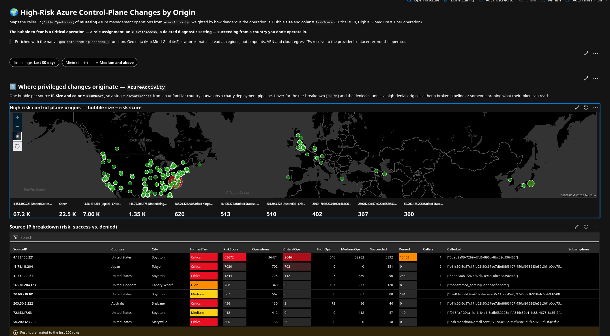

# Sentinel Risk Tiered Geo Map: Azure Control Plane Changes

I built a Microsoft Sentinel workbook that finds the location of the IP address behind every Azure management operation that changes something, scores each one by how dangerous it is, and plots the results on a risk scored map.

## The Problem

`AzureActivity` logs every management plane call, but treating every write, delete, and action as equally important buries the real signal. A role assignment from an unfamiliar country is not the same as a routine deployment. This workbook sorts operations into risk tiers before they reach the map, so the size of each bubble reflects how dangerous the activity is, not just how much of it there is.

## Risk Tiers

| Tier | Weight | Example operations |
|---|---|---|
| **Critical** | 10 | Role assignments, `elevateAccess`, deleting diagnostic settings or alert rules |
| **High** | 5 | Key Vault secret and access changes, NSG and firewall rule changes, storage key regeneration |
| **Medium** | 1 | VM run command and extension changes, SQL firewall rules, Logic App changes |
| *Low* | Not counted | Routine changes that don't match any list above |

## What's in This Folder

| File | Contents |
|---|---|
| [`azure-activity-georisk-workbook.json`](./azure-activity-georisk-workbook.json) | The full workbook: time range and minimum risk tier filters, summary tiles, the risk scored map, a timeline by tier, and breakdown tables by IP and by caller |
| [`screenshots/`](./screenshots) | The workbook showing the risk scored map with live control plane data |

## How to Deploy It

1. In Sentinel, go to **Workbooks → New → Advanced Editor** and paste in the JSON. You can also open an existing workbook and use **Edit → Advanced Editor → Gallery Template**.
2. Replace the placeholder resource ID (`/subscriptions/<your-subscription-id>/resourceGroups/<your-resource-group>/providers/Microsoft.OperationalInsights/workspaces/<your-workspace-name>`) with your own Log Analytics workspace. You can find it under the workspace's **Properties**.
3. Save it. During triage, set the **Minimum risk tier** filter to Critical to see only the most dangerous activity.

## Why I Built It This Way

- **The risk tiers are the real work, not the map.** The classifier is a `case()` statement that stops at the first match, so I check Critical first. If an operation fits more than one tier, it always gets the highest one.
- **Bubbles are sized by risk, not volume.** Both the size and color of each bubble come from `RiskScore`, not the number of operations, so a single Critical action stands out more than a busy CI/CD pipeline making hundreds of routine changes.
- **Low tier activity is left off the map on purpose** to keep the view focused. The tradeoff is that new Azure services won't show up until they're added to a tier, so the lists should be reviewed periodically.

## Limitations

- **IP location isn't always accurate.** Geolocation can be wrong, and attackers often use VPNs or cloud hosting to appear somewhere else. The map is a starting point for investigation, not proof of where someone actually is.

## Skills

- Microsoft Sentinel workbooks
- KQL
- Azure control plane logs (`AzureActivity`)
- Risk based detection design
- IP enrichment with `geo_info_from_ip_address()`
