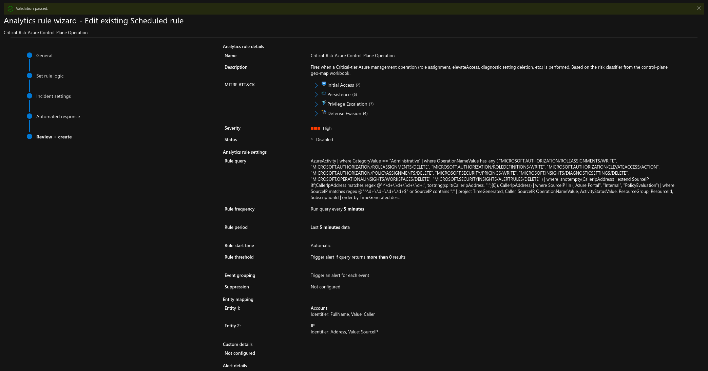
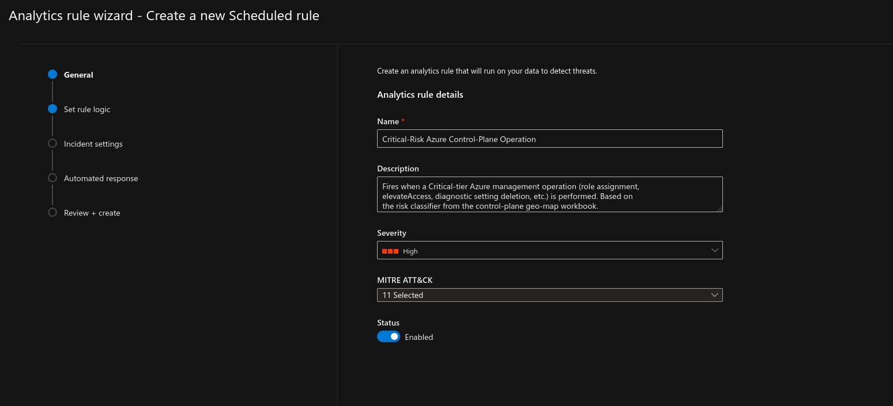
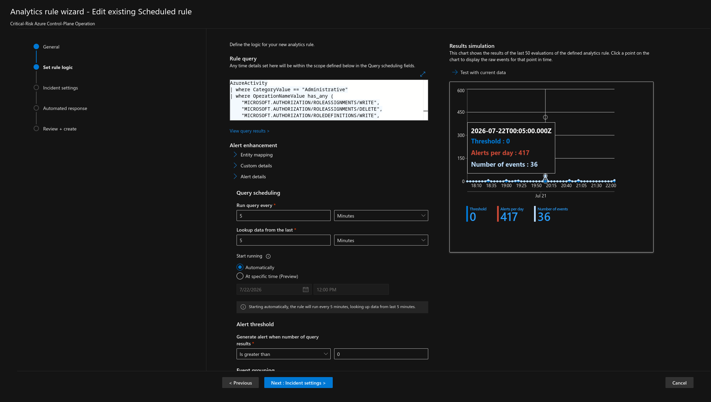
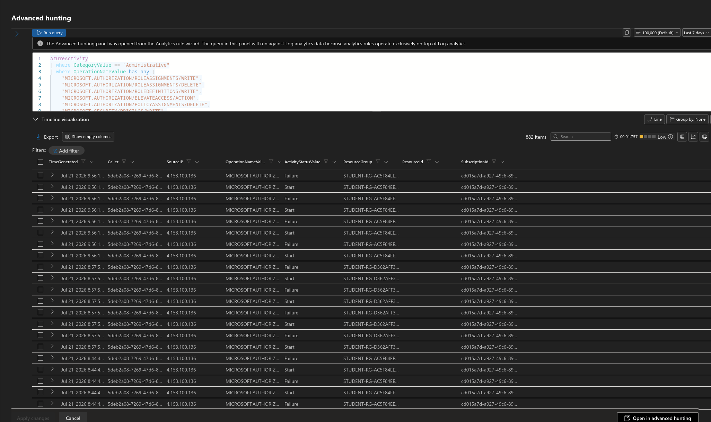
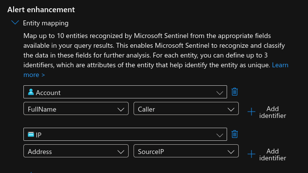
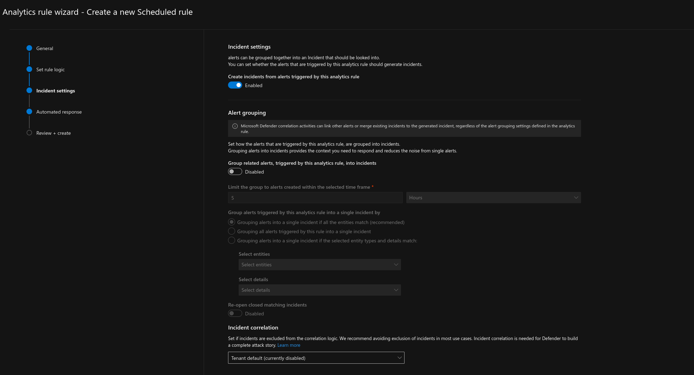

# Sentinel Analytics Rule: Critical Risk Control Plane Operations

I took the Critical tier from my [geo map workbook](../02-sentinel-geomap) risk classifier and turned it into a live Sentinel analytics rule with entity mapping, so the logic actively alerts instead of sitting in a dashboard.

> **This was a lab exercise in a shared environment.** I built and tested it in a shared community cyber range. I didn't connect any automated response (Teams or Jira) to this rule, so it wouldn't trigger shared infrastructure. I disabled the rule after capturing these screenshots.

## What's in This Folder

| File | Contents |
|---|---|
| [`analytics-rule.json`](./analytics-rule.json) | The exported rule: query, schedule, entity mappings, and MITRE ATT&CK techniques |
| [`screenshots/`](./screenshots) | Each step of the rule setup |

## How I Configured It

**General:** the rule name, description, severity, and MITRE ATT&CK techniques.

**Rule query and scheduling:** the Critical tier KQL, how often it runs, and the alert threshold. The results simulation shows the query returning real matches.

**Entity mapping:** I mapped Account (Caller) and IP (SourceIP), so every incident already includes the context an analyst needs without looking it up.

**Incident settings:** I turned off alert grouping on purpose. My reasons are below.

## Why I Built It This Way

- **I only included the Critical tier.** A High severity rule shouldn't fire on activity I already rated less urgent. Medium and High operations would need their own rule with their own severity.
- **One incident per Critical event.** The workbook groups activity by IP to make the map readable. This rule does the opposite on purpose, so unrelated operations don't get bundled together before an analyst sees them.
- **I turned off alert grouping.** Leaving it on would merge the separate alerts back together, which defeats the point of the query.
- **I didn't connect automated response.** The shared workspace already has live automation (Jira ticket creation) tied to other rules, and I avoided touching or triggering it.

## Testing Whether It Fires

To test the rule, I tried to give myself a limited Reader role on my own resource group. That's a small, reversible `roleAssignments/write` action that matches the Critical tier. The cyber range blocked it because student accounts can't change role assignments, even on their own resources. That turned out to be a useful finding: the environment applies least privilege even to small test actions, which is the same principle a real production tenant should follow. Because of that, I validated the rule through its query logic and configuration rather than a live incident screenshot.

## Skills

- Writing Sentinel analytics rules
- Entity mapping
- MITRE ATT&CK mapping
- Incident grouping and alert threshold design
- Safe testing in shared lab environments
