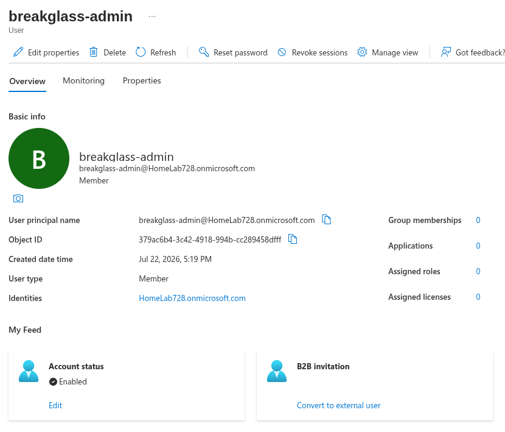
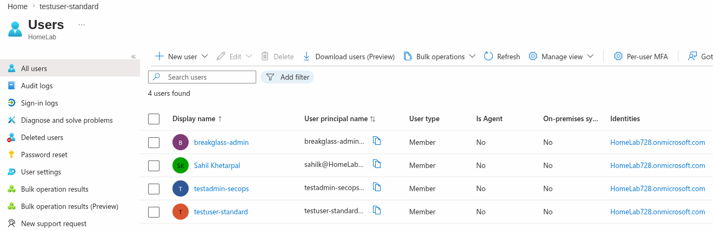
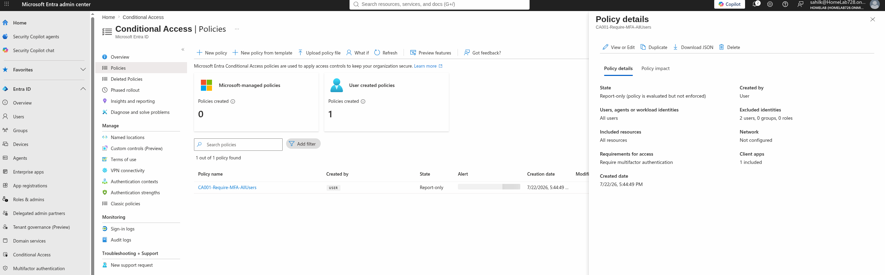
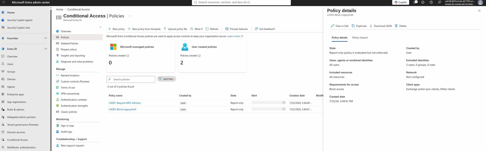
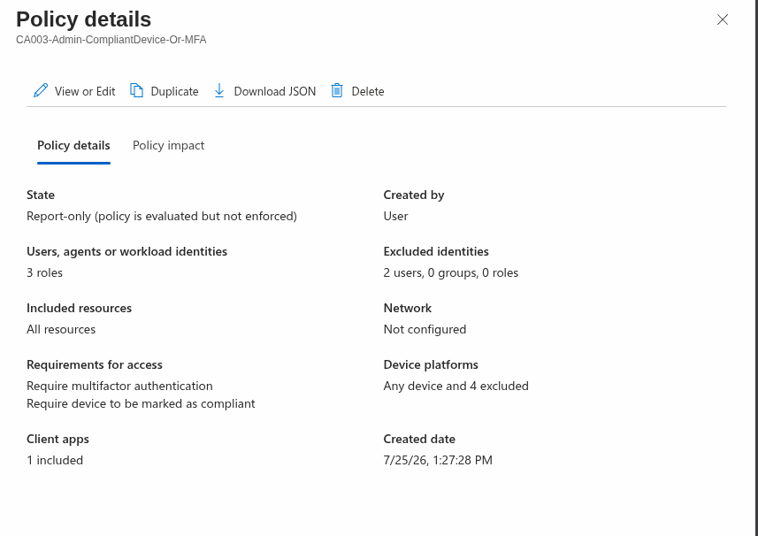
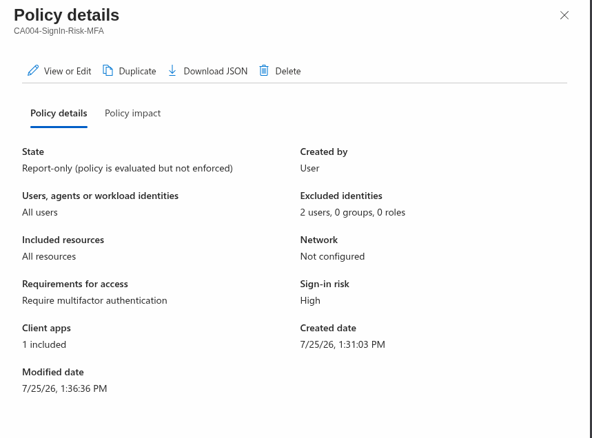
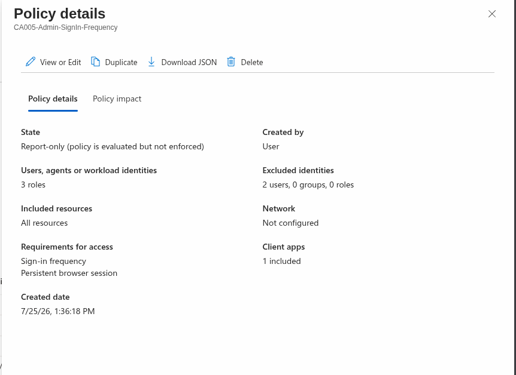
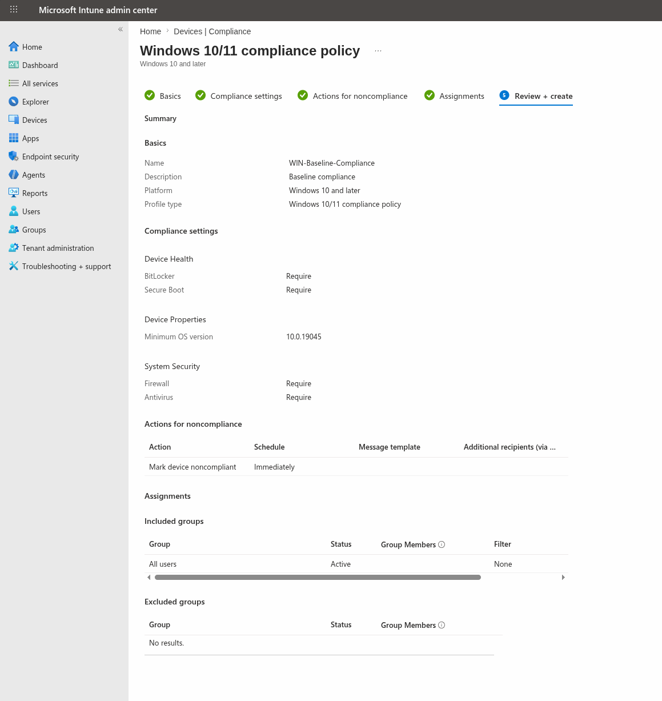
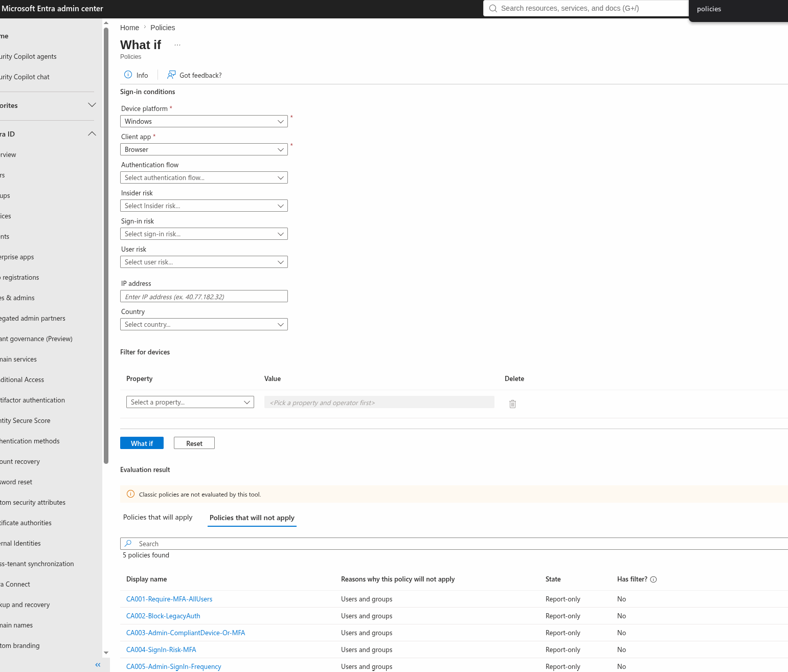

# Zero Trust and Conditional Access Policy Design

I built five Microsoft Entra Conditional Access policies and one Intune device compliance policy in a personal Microsoft 365 E5 trial tenant to practice Zero Trust identity controls.

> **This was a lab exercise in a personal tenant.** I built it in a Microsoft 365 E5 trial (`homelab728.onmicrosoft.com`) using a break glass admin account and test users. All identifiers in the exported JSON are redacted.

## What's in This Folder

| File | Contents |
|---|---|
| [`policies/ca-policies-export-redacted.json`](./policies/ca-policies-export-redacted.json) | All five CA policies, exported with Microsoft Graph PowerShell |
| [`policies/intune-compliance-export.json`](./policies/intune-compliance-export.json) | The Intune Windows compliance policy |
| [`scripts/Export-CAPolicies.ps1`](./scripts/Export-CAPolicies.ps1) | The script that exports both through the Graph SDK, using read only permissions |
| [`screenshots/`](./screenshots) | Policy configuration and "What If" test results |

## Setup

I created a break glass admin account, excluded from every policy, plus test users representing a standard account and a scoped admin role.

## The Policies

| Policy | Scope | Control |
|---|---|---|
| CA001-Require-MFA-AllUsers | All users | Require MFA |
| CA002-Block-LegacyAuth | All users | Block Exchange ActiveSync and other legacy clients |
| CA003-Admin-CompliantDevice-Or-MFA | Global Admin, Security Admin, Privileged Role Admin | Require a compliant device or MFA |
| CA004-SignIn-Risk-MFA | All users | Require MFA when sign in risk is Medium or High |
| CA005-Admin-SignIn-Frequency | Same admin roles as CA003 | Sign in again every 4 hours, no persistent browser session |

I tested all five with Entra's "What If" tool before deciding whether to enforce them. The results are in the Validation section below.

## Intune Compliance Policy (WIN-Baseline-Compliance)

I chose five settings, each one aimed at a specific threat rather than taken from a general hardening checklist:

| Setting | Threat it addresses |
|---|---|
| Require BitLocker | Device theft. Without disk encryption, anyone with the laptop has the data. |
| Require Secure Boot | Bootkits and rootkits that hide below the operating system |
| Minimum OS version (10.0.19045) | Unpatched, publicly known vulnerabilities |
| Require Firewall | Lateral movement and inbound exposure |
| Require Antivirus | Basic malware detection, and a control auditors specifically ask about |

**What I left out on purpose:** device password and PIN rules. Windows sign in requirements are already enforced through Entra ID and Windows Hello, and defining the same rule in two places means they can drift apart over time. I also left out **Attack Surface Reduction rules**, because they need to be tuned against the real software in an environment first. Turning them on without testing is a common cause of production outages.

**Known gap:** no devices are enrolled in this tenant, so the compliance policy is built and exported but has never checked a real device. That means CA003's "compliant device" option was validated by reviewing the configuration, not by live enforcement.

## Report Only vs. Enforced

I left the policies in report only mode. In a real environment, you want to test policies first and see how they affect users. Switching a policy straight to enforced would flood the help desk with calls from everyone who missed the announcement email or hadn't set up MFA yet. This is also a lab with no real sign in traffic to test against.

## Validation

Instead of trusting the configuration, I tested each policy with Entra's "What If" tool. I wrote down what I expected to happen before running each test, the same way you'd validate a detection rule before trusting its alerts.

Three results taught me more than a clean pass would have:

- **My admin account (`sahilk@...`) matched zero policies.** I had excluded it from all five while building them. That's correct during setup, but it isn't meant to be permanent.
- **The break glass account also matched zero policies.** Same result, but for a different reason. Its exclusion is permanent by design: a break glass account exists so someone can still sign in during an MFA outage or after a bad policy change. That's why it's protected by one very strong credential instead of the layered controls on every other account. It also means that publishing a policy set reveals its exception list, so I redacted the excluded object IDs from the exported JSON. The break glass account is the most valuable target in the tenant.
- **A legacy authentication sign in matched both CA001 (require MFA) and CA002 (block access).** When both apply, Block wins. That's the right outcome anyway, because legacy protocols can't do MFA at all, so requiring it would just be a slower way of blocking.

## Why I Built It This Way

- **A break glass account excluded from every policy.** This is standard Zero Trust practice. A bad Conditional Access policy or an MFA outage should never be able to lock every admin out of the tenant at once.
- **Report only before enforced, always.** An untested policy applied to all users can lock out the whole tenant, admins included, with one click. Report only mode evaluates real sign ins without applying the control, so you can check who it affects first.
- **Grant controls and session controls kept separate.** CA005 uses session controls (sign in frequency and no persistent browser session) instead of grant controls, because it limits how long an admin stays signed in, not whether they can sign in.

## Next Steps

- **CA006: block device code flow.** I haven't built this yet. Device code sign in is what I used to connect my PowerShell export script to Graph, and it's also a known phishing technique. An attacker generates a real code and tricks someone into entering it on the legitimate Microsoft login page, which hands the attacker a valid token. I ran into this flow firsthand while troubleshooting Graph authentication for this project. It's worth blocking with Entra's "Authentication flows" condition for any account that has no reason to use it.

## Skills

- Microsoft Entra Conditional Access
- Zero Trust policy design
- Intune device compliance
- Microsoft Graph PowerShell SDK
- Testing policies with Entra "What If"
- Least privilege API permissions (read only Graph scopes, verified)
